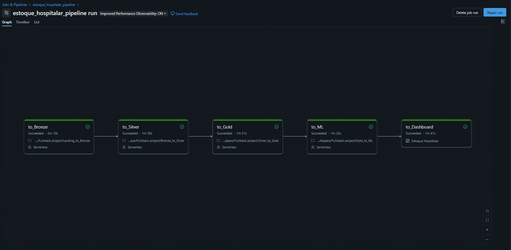

# Estoque Hospitalar: Lakehouse de Dados no Databricks

Pipeline de dados de ponta a ponta para a gestão de estoque de uma rede hospitalar. Extrações do ERP passam por uma Arquitetura Medalhão (Bronze, Silver e Gold), viram um modelo dimensional com marts analíticos, alimentam previsão de demanda e sugestão de compra e terminam em um dashboard AI/BI, tudo orquestrado por um Job no Databricks.

O projeto retoma um trabalho acadêmico de ciência de dados sobre estoque hospitalar, agora com foco em engenharia de dados. Os dados originais são confidenciais, então o repositório usa **dados sintéticos** de uma rede fictícia (Vale Verde), gerados a partir de padrões agregados da base real: volume, mix de operações, sazonalidade, concentração de itens e inconsistências típicas do ERP. Nenhum registro real foi utilizado.



## Arquitetura

```
Landing    extrações do ERP no Volume landing.erp (parquet mensais e cadastros em CSV)
   │
   ▼
Bronze     dado bruto em Delta via Auto Loader, com metadados de origem e _rescued_data
   │
   ▼
Silver     tipagem, padronização de chaves, deduplicação, regras de qualidade e quarentena
   │
   ▼
Gold       modelo dimensional, saldo diário reconstruído, marts analíticos e features de ML
   │
   ├──▶ ML         previsão de demanda, sugestão de compra, segmentação e consumo anômalo
   │
   └──▶ Dashboard  AI/BI sobre a Gold e as tabelas de ML
```

Todas as tabelas ficam no catálogo `estoque_hospitalar`, nos schemas `bronze`, `silver` e `gold`. O schema `landing` guarda os Volumes de arquivos e de checkpoints.

## Estrutura do repositório

```
├── notebooks/
│   ├── Landing_to_Bronze.ipynb
│   ├── Bronze_to_Silver.ipynb
│   ├── Silver_to_Gold.ipynb
│   └── Gold_to_ML.ipynb
├── pipeline/
│   └── job.yaml
├── dashboard/
│   └── estoque_hospitalar.lvdash.json
├── docs/
│   └── execucao_job.png
└── README.md
```

| Arquivo | Conteúdo |
|---|---|
| `notebooks/Landing_to_Bronze.ipynb` | Catálogo, schemas e Volumes, validação da landing e ingestão das 9 fontes com Auto Loader |
| `notebooks/Bronze_to_Silver.ipynb` | 13 tabelas Silver com tipagem, deduplicação, regras de qualidade, quarentena e histórico de locais |
| `notebooks/Silver_to_Gold.ipynb` | Dimensões, fatos, saldo diário reconstruído, conciliação com o ERP, marts e tabelas de features |
| `notebooks/Gold_to_ML.ipynb` | Previsão de demanda com backtest, sugestão de compra, segmentação e consumo anômalo |
| `pipeline/job.yaml` | Definição do Job de orquestração |
| `dashboards/estoque_hospitalar.lvdash.json` | Dashboard AI/BI exportado do workspace |

## Fontes

| Fonte | Formato | Conteúdo |
|---|---|---|
| `movimento_estoque` | parquet mensal | Saídas para paciente e setor, devoluções, perdas, vencidos e estornos (cerca de 2,66 milhões de linhas em 24 meses) |
| `nota_fiscal`, `nota_fiscal_item` | parquet mensal | Compras com fornecedor, datas, quantidade na unidade de compra e lote recebido |
| `lote_fornecedor` | parquet | Lotes com fabricação e validade |
| `saldo_estoque` | parquet mensal | Fechamento mensal por item, local e lote, incluindo o saldo de abertura |
| `cadastros` | CSV `;` | Materiais, operações, locais de estoque e fornecedores |

Os arquivos de dados não são versionados neste repositório.

## Tabelas por camada

**Bronze**
`tb_movimento_estoque`, `tb_nota_fiscal`, `tb_nota_fiscal_item`, `tb_lote_fornecedor`, `tb_saldo_estoque`, `tb_material`, `tb_operacao_estoque`, `tb_local_estoque`, `tb_fornecedor`

**Silver**
`tb_movimento_estoque`, `tb_nota_fiscal`, `tb_nota_fiscal_item`, `tb_lote_fornecedor`, `tb_saldo_estoque`, `tb_material`, `tb_operacao_estoque`, `tb_local_estoque`, `tb_local_estoque_historico`, `tb_estabelecimento`, `tb_centro_custo`, `tb_fornecedor`, `tb_quarentena`

**Gold**
- Dimensões: `dim_data`, `dim_material`, `dim_local`, `dim_centro_custo`, `dim_fornecedor`, `dim_operacao`
- Fatos: `fact_movimento`, `fact_compra`, `fact_estoque_diario`, `fact_lote_posicao`
- Qualidade: `qualidade_conciliacao_saldo`
- Marts: `mart_consumo_mensal`, `mart_indicadores_estoque`, `mart_curva_abc_xyz`, `mart_fornecedor`
- Features: `ml_demanda_semanal`, `ml_perfil_item`
- Resultados de ML: `ml_backtest_demanda`, `ml_metricas_demanda`, `ml_previsao_demanda`, `ml_sugestao_compra`, `ml_segmento_item`, `ml_anomalia_consumo`

## Orquestração

O Job `estoque_hospitalar_pipeline` executa cinco tarefas encadeadas:

```
to_Bronze  →  to_Silver  →  to_Gold  →  to_ML  →  to_Dashboard
```

- Cada tarefa só começa depois que a anterior termina com sucesso.
- `to_Bronze` interrompe o Job se a landing tiver menos arquivos que o mínimo, arquivo vazio, mês faltando ou cadastro ausente.
- `to_Gold` interrompe o Job se o saldo reconstruído divergir do fechamento do ERP em algum mês anterior ao último.
- `to_Dashboard` atualiza o dashboard publicado com os dados da execução.
- O parâmetro `catalogo` do Job é repassado ao widget de mesmo nome em todos os notebooks.

## Dashboard

Dashboard AI/BI com 12 datasets em SQL sobre a Gold e 6 páginas:

| Página | Conteúdo |
|---|---|
| Visão geral | Consumo, giro, taxa de ruptura, perdas, estoque atual e cobertura |
| Estoque | Valor e itens parados, ruptura por mês e por local, estoque por prazo de validade |
| Compras e curva ABC | Compras por mês e fornecedor, prazo, variação de preço, matriz ABC/XYZ e curva de Pareto |
| Previsão de demanda | WAPE do modelo contra os baselines, backtest e previsão das próximas 4 semanas |
| Sugestão de compra | Itens a comprar, valor estimado e itens abaixo do estoque de segurança |
| Monitoramento | Anomalias de consumo e conciliação do saldo com o ERP |

Indicadores de razão (taxa de ruptura, giro, WAPE) são métricas calculadas no dataset e recalculadas a cada filtro, em vez de médias de valores já agregados.

## Como executar

1. Importe os notebooks da pasta `notebooks` no Workspace do Databricks.
2. No `Landing_to_Bronze`, execute as seções 1 e 2 e faça o upload dos arquivos em `<catalogo>.landing.erp`, uma pasta por fonte.
3. Importe `dashboards/estoque_hospitalar.lvdash.json` no Workspace e publique o dashboard.
4. Crie o Job a partir do `pipeline/job.yaml`, ajustando os caminhos dos notebooks, o `dashboard_id` e o `warehouse_id`.

Desenvolvido na Databricks Free Edition, com computação serverless.

## Principais decisões

### Bronze
- **Auto Loader com `availableNow`**: processa só os arquivos novos e encerra. O checkpoint de cada tabela registra o que já foi lido, então reexecutar o Job não duplica dados.
- **Cadastros reenviados**: com `allowOverwrites`, um cadastro sobrescrito na landing é lido de novo; a Silver usa sempre o snapshot mais recente.
- **Sem tipagem**: CSVs são lidos como texto; a tipagem acontece na Silver.
- **Mudança de tipo na origem**: `cd_conta_contabil` chega como número nos primeiros meses e como texto depois. O schema hint fixa a coluna como texto e os valores numéricos vão para `_rescued_data`, sem quebrar a ingestão e sem perder dado.
- **Metadados de origem**: `_arquivo_origem`, `_dt_modificacao_arquivo` e `_dt_ingestao` em todas as tabelas.

### Silver
- **Chaves padronizadas**: o mesmo código tem o mesmo nome em todas as tabelas (`cd_material`, `nr_seq_lote`, `nr_seq_nota_fiscal`), o que não acontece na origem.
- **Deduplicação**: fatos pela chave natural, com desempate pela ingestão e pelo arquivo de origem; cadastros pelo snapshot mais recente.
- **Conta contábil**: recuperada de `_rescued_data` e normalizada sem o `.0`.
- **Datas do movimento**: lançamentos com ano digitado errado têm a data reconstruída a partir da competência (`fl_data_movimento_corrigida`). Lançamentos na competência seguinte ficam marcados (`fl_competencia_seguinte`).
- **Colunas descartadas**: `vl_estoque` e `vl_movimento_2` são cópias de outras colunas, `nr_lote_contabil` vem sempre vazio e `id_item` é derivado do código do material.
- **Quarentena**: registros que violam regras de qualidade vão para `tb_quarentena` com a lista de regras violadas, em vez de serem descartados em silêncio.
- **Dimensões derivadas**: centro de custo e histórico de nomes de local (SCD tipo 2) são montados a partir da movimentação, porque o ERP não exporta esses cadastros completos.

### Gold
- **Chaves naturais**: os códigos do ERP são únicos e estáveis, então as dimensões não usam chave substituta.
- **Saldo diário reconstruído**: saldo de abertura + entradas por nota + movimentações com o sinal da operação, com uma linha por item, local e dia (cerca de 1,85 milhão de linhas). O resultado é conciliado com o fechamento mensal do ERP e fecha em todos os meses; a única divergência é no último mês, com lançamentos do último dia que caíram na competência seguinte, fora da extração.
- **Ruptura**: saldo zerado com consumo nos 30 dias anteriores. Itens que ficam zerados na maior parte do tempo por política (alto custo comprado por prescrição) não contam como ruptura.
- **Consumo líquido**: saídas para paciente e setor menos devoluções. Perdas e vencidos ficam separados.
- **Curva ABC/XYZ**: ABC pelo valor consumido nos últimos 12 meses, XYZ pelo coeficiente de variação da demanda semanal.

### ML
- **Previsão por item e semana**: o grão de interesse para compras, somando todos os locais, com horizonte de 4 semanas e um único modelo para todos os horizontes.
- **Validação temporal**: treino até um corte e teste nas 13 semanas seguintes, comparado com dois baselines (última semana e média móvel de 4 semanas).
- **Resultado**: WAPE em torno de 0,21, contra 0,27 do baseline ingênuo. O modelo fica próximo da média móvel nos itens de maior giro e ganha nos de consumo irregular (classe C).
- **Sugestão de compra**: revisão periódica semanal com estoque de segurança pelo erro de previsão de cada item e nível de serviço por classe ABC. Os dados não têm pedidos em aberto, então o saldo em trânsito é considerado zero.
- **Segmentação**: K-Means com variáveis em log e número de grupos escolhido pelo silhouette.
- **Consumo anômalo**: desvio em relação à mediana das 12 semanas anteriores, medido em MAD; quedas em semanas com ruptura ficam marcadas como possível falta de estoque.

## Limitações

- **Dados sintéticos**: os indicadores e os resultados de ML refletem o gerador de dados, não uma operação real. O valor do projeto está na engenharia e na metodologia (ingestão incremental, qualidade, conciliação, validação temporal), não nos números em si.
- **Viés da previsão**: o alvo é treinado em `log1p`, o que leva o modelo a prever cerca de 9% abaixo do consumo real. Uma correção de viés ou uma perda Tweedie resolveria isso, e fica como próximo passo.
- **Anomalias sem gabarito**: não há rótulos de anomalia, então a detecção não tem métrica de acerto. O resultado é uma lista priorizada para revisão.